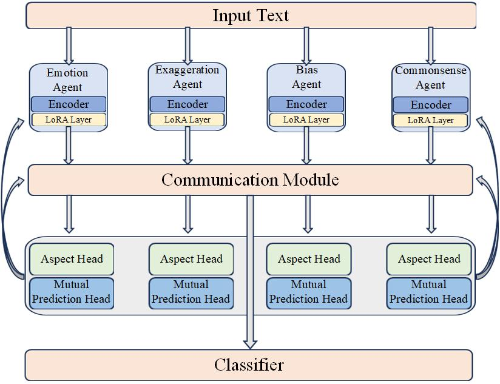

<div align="center">

# Aegis

### Multi-Agent Collaboration for News Classification

**Aspect-specific LoRA adaptation · Gated communication · Mutual prediction**

[](pyproject.toml)
[](Aegis/environment/requirements-train.in)
[](LICENSE)

[Architecture](#architecture) · [Getting Started](#getting-started) · [Data](#data-preparation) · [Reproduction](#training-and-inference) · [Evaluation](#evaluation-protocols) · [Citation](#citation)

</div>

## Overview

Aegis is a research codebase for studying collaboration among four neural agents in news classification. Each agent processes the same input through an independently instantiated pretrained backbone with its own LoRA adapters, and receives supervision for one textual aspect: **emotion, exaggeration, bias, or commonsense conflict**. A differentiable communication module exchanges information among the agents; a classifier predicts the task label from their fused representations.

The central research question is whether aspect supervision, representation exchange, and collaborative objectives improve classification over a single adapted model and simpler baselines. The implementation supports controlled ablations, fixed data partitions, multiple training seeds, and leave-one-event-out evaluation.

| Component | Purpose | Entry point |
| :--- | :--- | :--- |
| **Aegis neural model** | Train and evaluate the four-agent architecture shown below | [`Aegis/train.py`](Aegis/train.py) |
| **Two-stage LLM experiments** | Compare initial assessment, conditional review with generated references, and direct LLM classification | [`Agent/run_review_experiment.py`](Agent/run_review_experiment.py) |
| **Lightweight detector** | Run a standalone two-stage detector with a heuristic or HTTP provider | [`src/mafnd/`](src/mafnd/) (`mafnd` CLI) |

The API experiments and lightweight detector are separate implementations; they do not execute the neural model's LoRA or communication layers.

**Release scope.** This source release includes training, evaluation, data preparation, and offline test utilities. It does not bundle training datasets, pretrained backbone weights, trained Aegis checkpoints, or benchmark result archives. The commands below describe reproducible workflows; synthetic examples and simulated responses are functional demonstrations, not empirical evidence of model performance.

## Architecture

<p align="center">
  
</p>

<p align="center"><em>Figure 1. Four-agent architecture. Aspect and mutual prediction objectives provide auxiliary training signals; the fused representation supplies the final classifier.</em></p>

### Aspect-specific agents

| Agent | Intended supervision | CSV target |
| :--- | :--- | :--- |
| Emotion | Emotional or sensational framing | `emotion_label` |
| Exaggeration | Overstatement and exaggerated claims | `exaggeration_label` |
| Bias | Partisan, prejudicial, or one-sided framing | `bias_label` |
| Commonsense | Conflict with commonsense expectations | `commonsense_label` |

These are supervised textual dimensions, not independent factual verdicts. The agent names specify their training objectives; specialization must be assessed empirically.

The default backbone is **Qwen2.5-7B**, used through `AutoModel` to produce representations. Each of the four agents has separate backbone and adapter instances. Backbone parameters are frozen, while LoRA adapters and task heads are trainable. LoRA targets `q_proj` and `v_proj`; the default Qwen representation uses attention-mask-aware mean pooling over token states. See [`agent_base.py`](Aegis/agents/agent_base.py).

### Communication and prediction

The four pooled states form a tensor of shape `[batch, 4, hidden_size]`. Each communication round applies multi-head attention across agents, followed by a gated feed-forward residual update:

$$
\bar{H}^{(t)} = \operatorname{LN}_{\mathrm{pre}}(H^{(t)}), \qquad
M^{(t)} = \operatorname{MHA}(\bar{H}^{(t)}),
$$

$$
\begin{aligned}
G^{(t)} &= \sigma\!\left(W_g[\bar{H}^{(t)};M^{(t)}]+b_g\right), \\
H^{(t+1)} &= \operatorname{LN}_{\mathrm{post}}\!\left(H^{(t)}+G^{(t)}\odot\operatorname{FFN}(M^{(t)})\right).
\end{aligned}
$$

The default configuration uses two rounds, four attention heads, and mean fusion. Learned query-attention fusion and self-attention masking are configurable. A linear head maps the fused state to a binary task logit. Aspect heads operate on the corresponding post-communication agent states. See [`comm_module.py`](Aegis/communication/comm_module.py).

The mutual prediction blocks in Figure 1 correspond to **12 directed heads**, one for every ordered agent pair $i \ne j$. Each head predicts another agent's aspect probability from its own post-communication state, with the target probability detached from the gradient graph. The feedback arrows denote training signals, not additional text-generation or API calls.

### Learning objective

For aspect set $\mathcal{A}=\{\mathrm{emotion},\mathrm{exaggeration},\mathrm{bias},\mathrm{commonsense}\}$, the implemented objective is

$$
\begin{aligned}
\mathcal{L} ={}& \lambda_{\mathrm{final}}\mathcal{L}_{\mathrm{final}}
+ \sum_{a\in\mathcal{A}}\lambda_a\mathcal{L}_a
+ \lambda_{\mathrm{cons}}\mathcal{L}_{\mathrm{cons}} \\
&+ \lambda_{\mathrm{pred}}\mathcal{L}_{\mathrm{pred}}
+ \lambda_{\mathrm{div}}\mathcal{L}_{\mathrm{div}}
+ \lambda_{\mathrm{gate}}\mathcal{L}_{\mathrm{gate}}.
\end{aligned}
$$

| Term | Implementation |
| :--- | :--- |
| Final classification | Binary cross-entropy on the dataset task label |
| Aspect supervision | Weighted, masked binary cross-entropy on available aspect targets |
| Team consistency | MSE between the final probability and a learned aggregation of aspect probabilities, plus task-label BCE on that aggregation |
| Mutual prediction | Sum of probability MSE losses over the 12 directed agent pairs |
| Diversity | Squared batchwise aspect-probability correlations, averaged over the full matrix after zeroing its diagonal |
| Gate regularization | Mean absolute gate activation across samples, agents, and communication rounds |

The default schedule uses two warm-up epochs followed by four collaborative epochs. Final and aspect losses are active during warm-up; the four collaborative loss weights start at zero and increase linearly during the collaborative phase. **Communication remains active during warm-up.** Implementation details are in [`trainer.py`](Aegis/training/trainer.py) and [`losses.py`](Aegis/training/losses.py).

## Getting Started

Commands use Bash and start at the repository root unless a block explicitly changes directory. On Windows PowerShell, activate the virtual environment with `.venv\Scripts\Activate.ps1`; the pinned GPU training environment below targets Linux.

### Lightweight installation and offline example

The installable package requires Python 3.10 or later and has no mandatory third-party runtime dependencies.

```bash
git clone https://github.com/Fujizzz/Aegis.git
cd Aegis
python -m venv .venv
source .venv/bin/activate
python -m pip install -e .

mafnd --provider heuristic --title "News report" --text "An official report was published today."
mafnd --provider heuristic --input examples/news.csv --output outputs/predictions.csv
```

The heuristic provider exercises the detector without an API key or model download. It is not a trained Aegis checkpoint. The CLI uses fake/real semantics; use the neural or review-experiment entry points for explicit PHEME label protocols.

### Neural training environment

The training preflight enforces **CPython 3.12.14 on Linux x86_64** and exact package versions. The lockfile targets glibc 2.28 or later and CUDA 12.4. Create a separate environment with that interpreter, then install the hash-locked profile:

```bash
python --version  # Must report Python 3.12.14 in this environment.
python -m pip install --require-hashes -r Aegis/environment/requirements-train-linux.lock
python -m pip install -e .
python Aegis/check_environment.py --profile training
```

Core versions include PyTorch 2.6.0, Transformers 4.49.0, PEFT 0.14.0, Accelerate 1.4.0, and bitsandbytes 0.45.3. The complete environment is recorded in the [training lockfile](Aegis/environment/requirements-train-linux.lock).

Four separate 7B backbones have substantial memory requirements even with 4-bit loading. [`config.yaml`](Aegis/config.yaml) places all modules on `cuda:0`; adjust `hardware.device_map` for your hardware. Generated experiment matrices use **two distinct GPUs**, `cuda:0` and `cuda:1`, and include device and checkpoint-recovery acceptance stages. No minimum VRAM or training-time benchmark is published in this release.

For CPU tests of small locally constructed neural models, install the CPU wheel and development extras in a separate compatible environment:

```bash
python -m pip install torch==2.6.0 --index-url https://download.pytorch.org/whl/cpu
python -m pip install -e '.[neural,dev]'
```

This test setup does not satisfy the pinned GPU training preflight. The legacy SDK-based `Agent/run_detector.py` entry point additionally uses the `api` extra: `python -m pip install -e '.[api]'`.

## Data Preparation

### Task and label semantics

The neural model and review experiments require an explicit label schema. In both schemas, the model's positive target is `1`, but the underlying tasks and source encodings differ:

| Schema | Task | Source labels | Model targets | Positive probability |
| :--- | :--- | :--- | :--- | :--- |
| `pheme_rumour_v1` | Rumour detection | `0 = non_rumour`, `1 = rumour` | Unchanged | `p_rumour` |
| `archive_fake_v1` | Fake-news classification | `0 = fake`, `1 = real` | `0 = real`, `1 = fake` | `p_fake` |

**A PHEME rumour label does not establish that a claim is false.** Interpret results according to the selected task; do not merge rumour-detection and fake-news metrics into one comparison. Label conversion is defined in [`label_schema.py`](Aegis/utils/label_schema.py).

Neural training CSVs require `label` and either `text` or `content`. Optional metadata include `sample_id`, `title`, `subject`, `date`, and `event` / `event_name`. Aspect-supervised training also uses `{aspect}_label` targets in `[0, 1]` and optional nonnegative `{aspect}_weight` fields. Missing targets are masked; an explicit zero weight disables that target's contribution. Keep identifiers as strings to preserve source identity.

### Prepare the five-event PHEME release

Obtain `all-rnr-annotated-threads.tar.gz` from the [official PHEME dataset](https://figshare.com/articles/dataset/PHEME_dataset_of_rumours_and_non-rumours/4010619), then run:

```bash
python tools/prepare_data.py \
  --archive /path/to/all-rnr-annotated-threads.tar.gz \
  --output data/pheme --seed 42
```

The preparation pipeline selects `charliehebdo`, `ferguson`, `germanwings-crash`, `ottawashooting`, and `sydneysiege`. It groups records using source identity, thread membership, normalized text, and lexical near-duplicate relations before assigning groups to train/validation/test partitions, targeting an 80/10/10 ratio. The output includes per-event splits, a protocol, and a content-hash manifest. Group constraints can change the realized ratios; use the generated counts when reporting experiments.

### Generate aspect supervision

The following workflow obtains teacher scores for training records and publishes a new dataset version. Set `DEEPSEEK_API_KEY` in the environment before the generation step; `--execute` makes real API requests.

```bash
cd Aegis
python -m utils.pseudo_quality audit \
  --source ../data/pheme --output ../outputs/teacher-plan
python -m utils.pseudo_quality generate \
  --plan ../outputs/teacher-plan/request_plan.json \
  --output ../outputs/teacher-responses.jsonl --execute
python -m utils.pseudo_quality audit \
  --source ../data/pheme --plan ../outputs/teacher-plan/request_plan.json \
  --responses ../outputs/teacher-responses.jsonl --output ../outputs/teacher-audit
cd ..
python tools/teacher_release.py \
  --source data/pheme --audit outputs/teacher-audit --output data/pheme_teacher
```

Teacher scores supervise textual aspects; the dataset's original main-task labels remain unchanged. This entry point records the release as **`teacher_only`**, without a human-validation claim. Preserve the request plan, response archive, audit outputs, and release manifest when reporting results. To study classification without aspect supervision, select the `no_dim` variant explicitly.

## Training and Inference

### Prepare the backbone

```bash
python tools/prepare_model.py --download
```

This downloads `Qwen/Qwen2.5-7B` at revision `d149729398750b98c0af14eb82c78cfe92750796` to `models/Qwen2.5-7B` and writes `models/model_manifest.json`. For existing weights, use `python tools/prepare_model.py --source /path/to/model --manifest models/model_manifest.json` and set the same model directory in the configuration.

### Default configuration

[`Aegis/config.yaml`](Aegis/config.yaml) is the starting configuration for the `sydneysiege` event:

| Setting | Default |
| :--- | :--- |
| Backbone / loading | Qwen2.5-7B / 4-bit NF4 with double quantization |
| LoRA rank / alpha / dropout | `8` / `16` / `0.1` |
| LoRA target modules | `q_proj`, `v_proj` |
| Communication rounds / heads / fusion | `2` / `4` / mean |
| Maximum input length | `384` tokens |
| Batch size / gradient accumulation | `4` / `2` (nominal effective batch: `8`) |
| Warm-up / collaborative epochs | `2` / `4` |
| Learning rate / weight decay | `5e-5` / `0.01` |
| Final / each aspect loss weight | `1.0` / `0.6` |
| Consistency / mutual prediction / diversity / gate weights | `0.5` / `0.2` / `0.1` / `0.01` (end of ramp) |
| Seed / validation selection metric | `42` / positive-class binary F1 |
| Decision threshold | `0.5`, fixed before test evaluation |

### Train and evaluate

After preparing the environment, teacher-supervised data, and backbone, verify the paths and device map in the configuration. Training paths, including relative `--save_dir` overrides, resolve against the configuration file's directory. Use a new run directory:

```bash
cd Aegis
python train.py --config config.yaml --save_dir ../outputs/runs/full-s42
python evaluate.py ../outputs/runs/full-s42/test_predictions.csv \
  --output ../outputs/evaluation/full-s42
cd ..
```

The training run archives its resolved configuration, input data, model identity, logs, and prediction artifacts. `best/` records the checkpoint selected on validation data; `last/` records the latest complete epoch. Resume into a new directory with:

```bash
cd Aegis
python train.py --resume ../outputs/runs/full-s42/last \
  --save_dir "$PWD/../outputs/runs/full-s42-resumed"
cd ..
```

Resume restores the saved training state, including optimizer, scheduler, random states, and historical best-model selection. It resumes at an **epoch boundary**, rather than reconstructing an interrupted partial epoch. The absolute output path above avoids resolving the new run relative to the checkpoint's saved configuration. Retain the matching local backbone and model manifest.

### Predict with a trained checkpoint

```bash
cd Aegis
python infer.py --checkpoint_dir ../outputs/runs/full-s42/best \
  --text "News body to classify." --device cuda:0
python predict_csv.py --checkpoint_dir ../outputs/runs/full-s42/best \
  --input ../data/pheme_teacher/split_sydneysiege/test.csv \
  --output ../outputs/reexported-test.csv --split test
cd ..
```

`infer.py` accepts a single text or `--input_json` news object and returns the task, label schema, predicted class, and positive-class probability. `predict_csv.py` exports predictions for a **labeled** CSV and preserves sample and checkpoint provenance. Its output path must be new. Trained weights are required for both commands.

## Evaluation Protocols

### Within-event experiments

Prepare the experiment matrix after publishing the frozen teacher-supervised dataset:

```bash
export AEGIS_SOURCE_ROOT="$PWD/Aegis"
export AEGIS_DATA_ROOT="$PWD/data/pheme_teacher"
export AEGIS_MODEL_ROOT="$PWD/models/Qwen2.5-7B"
export AEGIS_MODEL_MANIFEST="$PWD/models/model_manifest.json"
export AEGIS_RUNS_ROOT="$PWD/outputs/runs"

cd Aegis
python prepare_experiments.py --source ../data/pheme_teacher \
  --output ../outputs/matrix --seeds 42 43 44 --include-baselines
python run_experiments.py --matrix ../outputs/matrix/matrix.json \
  --output ../outputs/pipeline --stage all
cd ..
```

The second command prints the execution plan. On the configured training server, execute and summarize it with:

```bash
cd Aegis
python run_experiments.py --matrix ../outputs/matrix/matrix.json \
  --output ../outputs/pipeline --stage all --execute
python summarize_experiments.py --matrix ../outputs/matrix/matrix.json \
  --pipeline ../outputs/pipeline --output ../outputs/summary
cd ..
```

The pipeline runs device and recovery acceptance, the pilot experiment, same-split baselines, ablations, and remaining seeds. `--include-baselines` includes a single-agent LoRA model, TF-IDF with multinomial Naive Bayes, and direct teacher classification; the teacher baseline requires API credentials and makes real requests during execution. Text/API baselines run once per event, not once per neural training seed. Frozen split membership is unchanged across seeds.

| Core variant | Change relative to `full` |
| :--- | :--- |
| `no_comm` | Zero communication rounds; unchanged agent states with arithmetic mean fusion |
| `no_dim` | Disable aspect supervision |
| `no_gate` | Replace learned communication gates with ones; disable gate regularization |
| `no_cons` | Remove the team-consistency objective |
| `no_pred` | Remove mutual prediction |
| `no_div` | Remove the diversity penalty |
| `no_gate_loss` | Remove gate regularization while retaining learned gates |

The option resolver also supports `no_collab` and `custom` configurations. These are not part of the generated core matrix. See [`options.py`](Aegis/training/options.py).

### Leave-one-event-out experiments

Using the same model/source environment variables, prepare a separate cross-event matrix:

```bash
export AEGIS_CROSS_DATA_ROOT="$PWD/outputs/cross-event/frozen"

cd Aegis
python prepare_cross_event.py --source ../data/pheme_teacher \
  --output ../outputs/cross-event --seeds 42 43 44 --include-baselines
python run_experiments.py \
  --matrix ../outputs/cross-event/experiment_plan/matrix.json \
  --output ../outputs/cross-pipeline --stage all
cd ..
```

As above, add `--execute` to run the plan and use `summarize_experiments.py` with that matrix and a separate summary directory. Each fold tests on all records from one held-out event. Training uses the other events' inherited training partitions; validation combines their inherited validation and test partitions. Source-side groups touching the held-out event are excluded. Validation and test files omit aspect supervision. Fix hyperparameters before inspecting any held-out results.

### Metrics and reporting

The default protocol selects checkpoints by **validation positive-class F1**, breaking ties in favor of the first epoch. It reports accuracy, positive-class precision/recall/F1, class-macro F1, and ROC-AUC from continuous probabilities. Metrics use the `[0, 1]` scale; single-class ROC-AUC is undefined and remains `null`.

Report within-event and cross-event results separately. Distinguish equal-event averages from sample-pooled metrics, and report mean and sample standard deviation across complete neural-seed runs. Do not pool repeated seeds as additional independent samples or treat overlapping cross-fold validation populations as independent. The summarizer preserves missing or incomplete comparisons instead of manufacturing scores.

No verified benchmark scores are included in this release. A research report should accompany each result with the commit, configuration, data and model manifest hashes, label schema, split protocol, seeds, hardware, and per-sample predictions. Additional analysis entry points are [`analyze_run.py`](Aegis/analyze_run.py), [`benchmark_checkpoint.py`](Aegis/benchmark_checkpoint.py), and [`summarize_costs.py`](Aegis/summarize_costs.py); use `--help` for their required inputs.

## Two-Stage LLM Experiments

The API-based workflow first assesses the four textual aspects, then conditionally generates positive/negative reference texts and reviews the input against them. Its experiment runner compares **first-layer-only**, **full two-layer**, and **direct LLM** predictions on a shared input population. The first two conditions reuse the same initial assessment.

Run the supplied synthetic example offline:

```bash
python Agent/run_review_experiment.py --config Agent/examples/review_archive.json \
  --output outputs/review-plan
python Agent/run_review_experiment.py --config Agent/examples/review_archive.json \
  --output outputs/review-mock --simulate
python Agent/run_review_experiment.py --output outputs/review-mock --analyze-only
```

For real requests, set `DEEPSEEK_API_KEY`, select the appropriate schema and model in the configuration, and use an absolute input path and a separate output directory:

```bash
python Agent/run_review_experiment.py --config Agent/examples/review_archive.json \
  --input /absolute/path/to/news.csv --output outputs/review-api \
  --execute --max-samples 20
```

Use [`review_pheme.json`](Agent/examples/review_pheme.json) for PHEME semantics. `reference_context` controls whether reference generation receives metadata only (`metadata_only`) or also the article body (`with_content`). Generated references are model-produced comparison material, not retrieved evidence.

Repeating the same command resumes pending samples from the archived responses. `--max-samples` caps pending samples processed in that invocation. Outputs include `stage_predictions.csv`, `comparison_metrics.csv`, `review_gain.csv`, `api_costs.csv`, and `summary.json`. Review gain counts corrections minus newly introduced errors; reports also track coverage, abstention, trigger subsets, tokens, latency, and retries. `full_two_layer` costs include initial assessment; `physical_total` counts actual requests.

## Repository Structure

```text
Aegis/
├── Aegis/                 # Neural training and research experiments
│   ├── agents/            # Backbone, LoRA, and aspect heads
│   ├── communication/     # Attention, gates, and representation fusion
│   ├── training/          # Trainer, objectives, variants, and metrics
│   ├── inference/         # Checkpoint-based prediction
│   ├── baselines/         # Text and teacher baselines
│   ├── utils/             # Data protocols, provenance, and analysis
│   ├── environment/       # Pinned dependency profiles
│   └── tests/             # Neural and reproducibility tests
├── Agent/                 # Two-stage API detector and experiment runner
├── src/mafnd/             # Installable lightweight detector and CLI
├── tools/                 # Data, backbone, and teacher-release preparation
├── examples/              # Small demonstration inputs
├── tests/                 # Lightweight detector and API contract tests
├── docs/assets/           # Architecture figure
└── .github/workflows/     # Offline continuous integration
```

## Tests

With the neural and development dependencies installed:

```bash
python -m unittest discover -s Aegis/tests -v
python -m unittest discover -s Agent/tests -v
python -m pytest tests -v
```

Tests cover label semantics, gradient flow, checkpoint recovery, data grouping, ablations, prediction re-evaluation, API failures, and cost accounting. Neural tests construct small local models; API tests use simulated responses. The [CI workflow](.github/workflows/tests.yml) runs offline checks rather than full Qwen training or live API benchmarks.

## Limitations

- Aspect scores describe textual cues and may inherit teacher-model biases. Agreement with teacher scores does not establish factual correctness or human-validated interpretability.
- Lexical grouping reduces detectable overlap but cannot rule out every semantic paraphrase. Pretrained models and API teachers may already contain knowledge of held-out events.
- API model aliases need not identify immutable weights. Preserve raw responses and usage records when comparing runs.
- Classification probabilities and generated reference texts do not replace independent evidence verification. This release does not establish deployment accuracy, probability calibration, or cross-domain robustness.

## Citation

To reference this software release, use the repository citation below and record the exact commit used in your experiment. This is a software citation, not a publication reference.

```bibtex
@software{fujizzz2026aegis,
  author  = {{Fujizzz}},
  title   = {Aegis: Multi-Agent Collaboration for News Classification},
  year    = {2026},
  version = {0.1.0},
  url     = {https://github.com/Fujizzz/Aegis}
}
```

## License and Acknowledgments

The project code is released under the [MIT License](LICENSE). Model weights, datasets, and third-party dependencies retain their respective licenses and access conditions. This implementation builds on [PyTorch](https://pytorch.org/), [Transformers](https://github.com/huggingface/transformers), [PEFT](https://github.com/huggingface/peft), [Qwen2.5-7B](https://huggingface.co/Qwen/Qwen2.5-7B), and the [PHEME dataset](https://figshare.com/articles/dataset/PHEME_dataset_of_rumours_and_non-rumours/4010619).
