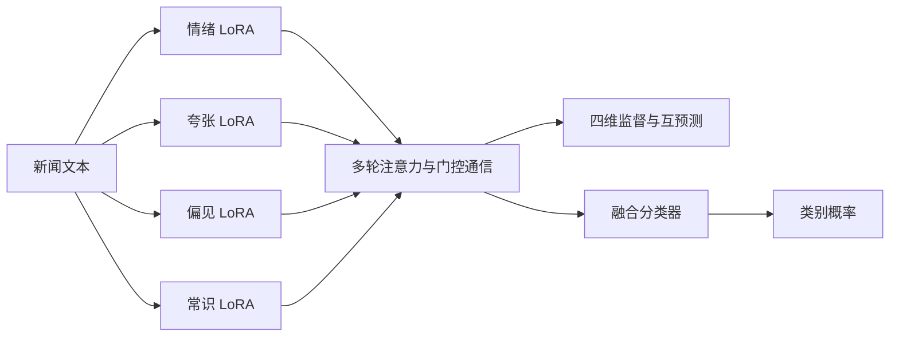

# Aegis

**Four-agent LoRA collaboration and two-stage LLM news classification.**

Aegis 将新闻文本分解为情绪煽动、夸张程度、偏见倾向和常识冲突四个维度，通过独立 LoRA 编码器与门控通信完成协同分类。仓库同时提供生成参考稿的双层 API 检测器，以及可直接安装的轻量命令行工具。

## 功能

- **四智能体协同学习**：独立 LoRA、维度监督、多轮注意力通信、门控融合、团队一致性、互预测和多样性损失。
- **训练与推理**：梯度累积、4-bit/8-bit 加载、设备映射、完整 epoch 恢复、最佳模型选择、批量及单条预测。
- **实验管理**：同划分基线、机制消融、多随机种子、五折留一事件评估和统一指标汇总。
- **双层 API 检测**：四维初筛、条件路由、生成正负参考稿、四维接近度复核，以及直接 LLM 对照。
- **分析与追溯**：逐样本概率、纠错/改错/净收益、触发样本表现、token/延迟/重试统计、维度一致性、稳定性和案例导出。
- **数据处理**：字符串样本身份、近重复分组、固定划分、教师维度评分及带哈希的数据版本。

## 架构



训练目标由最终分类、维度监督、团队一致性、互预测、多样性和门控正则组成：

```text
L = L_final + λ_dim L_dim + λ_cons L_cons
  + λ_pred L_pred + λ_div L_div + λ_gate L_gate
```

## 目录

| 路径 | 内容 |
| --- | --- |
| `Aegis/` | 神经模型、训练、推理、基线和实验分析 |
| `Agent/` | 原始双层 API 检测与统一对照实验 |
| `src/mafnd/` | 轻量检测器、HTTP provider 和 `mafnd` CLI |
| `tools/` | 数据准备、模型下载和教师监督数据发布 |
| `tests/` | API 契约与轻量 CLI 测试 |
| `.github/workflows/` | 自动化测试 |

## 安装

轻量 CLI 和双层实验的离线模拟可使用 Python 3.10+；神经模型环境使用 Python 3.12。

```bash
git clone https://github.com/Fujizzz/Aegis.git
cd Aegis
python -m venv .venv
source .venv/bin/activate
python -m pip install -e .
```

Windows PowerShell 激活环境：`.venv\Scripts\Activate.ps1`。

CPU 神经模型测试：

```bash
python -m pip install torch==2.6.0 --index-url https://download.pytorch.org/whl/cpu
python -m pip install -e '.[neural,dev]'
```

Linux CUDA 12.4 训练环境的完整版本及文件哈希位于 `Aegis/environment/requirements-train-linux.lock`：

```bash
python -m pip install --require-hashes -r Aegis/environment/requirements-train-linux.lock
python -m pip install -e .
```

使用 `Agent/run_detector.py` 的 SDK 入口时安装 `python -m pip install -e '.[api]'`。

## 快速开始

轻量离线检测：

```bash
mafnd --provider heuristic --title "News report" --text "An official report was published today."
mafnd --provider heuristic --input examples/news.csv --output outputs/predictions.csv
```

双层实验默认生成计划，`--simulate` 执行本地模拟，`--execute` 执行真实 API 请求：

```bash
python Agent/run_review_experiment.py --config Agent/examples/review_archive.json --output outputs/review-plan
python Agent/run_review_experiment.py --config Agent/examples/review_archive.json --output outputs/review-mock --simulate
python Agent/run_review_experiment.py --output outputs/review-mock --analyze-only
```

配置中设置输入 CSV、模型和标签协议，通过 `DEEPSEEK_API_KEY` 环境变量提供 API 密钥。真实请求使用独立输出目录：

```bash
python Agent/run_review_experiment.py --config Agent/examples/review_archive.json --input /path/to/news.csv --output outputs/review-api --execute --max-samples 20
```

再次执行相同命令会复用已保存响应，继续处理后续样本。`--max-samples` 是本次处理的待完成样本数量。每次请求记录原始响应、usage、耗时和重试；模型与数据配置由哈希绑定。三路对照为第一层、完整双层、直接 LLM，前两路共享初筛响应。

输出包括 `stage_predictions.csv`、`comparison_metrics.csv`、`review_gain.csv`、`api_costs.csv` 和 `summary.json`。净收益为纠错数减改错数；覆盖率、复核弃权、触发/未触发及共同成功样本分别统计。`full_two_layer` 的成本包含初筛，`physical_total` 表示实际请求总量。`reference_context` 可选择 `metadata_only` 或 `with_content`，分别控制参考稿生成时的上下文。

## 数据与标签

CSV 输入包含 `text` 或 `content`、`label`，以及可选的 `sample_id,title,subject,date,event`。神经模型的维度监督字段为 `emotion_label`、`exaggeration_label`、`bias_label` 和 `commonsense_label`。

| 标签协议 | 原始标签 | 模型正类概率 |
| --- | --- | --- |
| `pheme_rumour_v1` | 0=non_rumour，1=rumour | `p_rumour` |
| `archive_fake_v1` | 0=fake，1=real | `p_fake`，目标编码转换为 0=real、1=fake |

PHEME 使用发帖时的谣言/非谣言任务定义；API 提示词随协议选择。数据分组采用样本身份、线程、规范化正文和词面近重复关系，组内样本进入同一划分。

从 [PHEME 数据集](https://figshare.com/articles/dataset/PHEME_dataset_of_rumours_and_non-rumours/4010619) 获取原始归档后：

```bash
python tools/prepare_data.py --archive /path/to/all-rnr-annotated-threads.tar.gz --output data/pheme --seed 42
```

生成教师评分计划并按响应发布带四维监督的数据：

```bash
cd Aegis
python -m utils.pseudo_quality audit --source ../data/pheme --output ../outputs/teacher-plan
python -m utils.pseudo_quality generate --plan ../outputs/teacher-plan/request_plan.json --output ../outputs/teacher-responses.jsonl --execute
python -m utils.pseudo_quality audit --source ../data/pheme --plan ../outputs/teacher-plan/request_plan.json --responses ../outputs/teacher-responses.jsonl --output ../outputs/teacher-audit
cd ..
python tools/teacher_release.py --source data/pheme --audit outputs/teacher-audit --output data/pheme_teacher
```

教师分数作为维度监督，主任务标签保持数据集定义；输出保留评分来源和发布策略。

## 基础模型、训练和推理

下载固定版本 Qwen2.5-7B 并建立本地模型内容清单：

```bash
python tools/prepare_model.py --download
```

已有本地模型时使用 `--source /path/to/model --manifest models/model_manifest.json`，并在配置中设置同一模型目录。主配置为 `Aegis/config.yaml`，数据、模型和运行目录均可调整。

```bash
cd Aegis
python train.py --config config.yaml
python train.py --resume /path/to/checkpoint/last --save_dir /path/to/new-run
python infer.py --checkpoint_dir /path/to/run/best --text "News body" --device cuda:0
python predict_csv.py --help
python evaluate.py /path/to/run/test_predictions.csv --output ../outputs/evaluation
```

检查点保存四个 Agent、通信与分类模块、优化器、调度器、随机状态和历史最佳选择。训练入口从完整 epoch 边界继续，运行配置、数据身份及模型哈希共同绑定。

## 实验矩阵

事件内矩阵覆盖五个事件、指定种子、完整模型和机制消融，并可加入单 Agent LoRA、TF-IDF+NB、教师直接分类：

```bash
cd Aegis
python prepare_experiments.py --source ../data/pheme_teacher --output ../outputs/matrix --seeds 42 43 44 --include-baselines
```

设置矩阵需要的路径变量：

```bash
export AEGIS_SOURCE_ROOT="$(pwd)"
export AEGIS_DATA_ROOT="$(cd ../data/pheme_teacher && pwd)"
export AEGIS_MODEL_ROOT="$(cd ../models/Qwen2.5-7B && pwd)"
export AEGIS_MODEL_MANIFEST="$(cd ../models && pwd)/model_manifest.json"
export AEGIS_RUNS_ROOT="$(cd .. && pwd)/outputs/runs"
python run_experiments.py --matrix ../outputs/matrix/matrix.json --output ../outputs/pipeline --stage all
python run_experiments.py --matrix ../outputs/matrix/matrix.json --output ../outputs/pipeline --stage all --execute
python summarize_experiments.py --matrix ../outputs/matrix/matrix.json --pipeline ../outputs/pipeline --output ../outputs/summary
```

调度器按设备检查、恢复检查、单事件运行、基线、消融和多种子顺序执行，续跑时核对并跳过已完成项。

留一事件评估：

```bash
python prepare_cross_event.py --source ../data/pheme_teacher --output ../outputs/cross-event --seeds 42 43 44 --include-baselines
```

将 `AEGIS_CROSS_DATA_ROOT` 指向生成的 `frozen` 目录，再对 `experiment_plan/matrix.json` 使用同一调度器和汇总器。各折以源事件验证集选模型，留出事件用于测试。

分析入口：

```bash
python analyze_run.py --help
python benchmark_checkpoint.py --help
python summarize_costs.py --help
```

## 测试

```bash
python -m unittest discover -s Aegis/tests -v
python -m unittest discover -s Agent/tests -v
python -m pytest tests -v
```

测试覆盖标签协议、训练梯度、检查点恢复、数据分组、基线/消融、预测重算、阶段对照、失败处理和 API 成本统计。神经测试使用本地构造的小型模型，API 测试使用模拟响应。

## 许可证

项目代码采用 [MIT License](LICENSE)。第三方依赖按各自许可证分发；基础模型和数据通过准备入口接入，来源分别为 [Qwen2.5-7B](https://huggingface.co/Qwen/Qwen2.5-7B) 和 PHEME。
